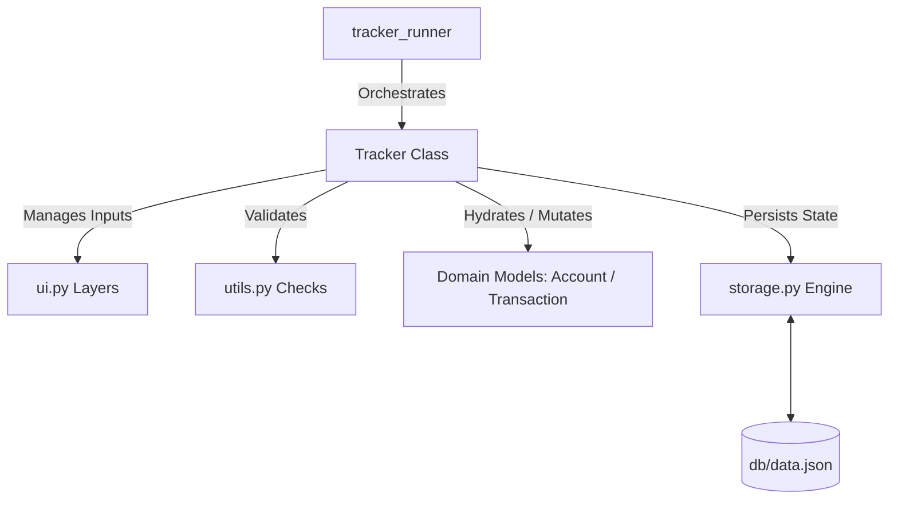

# Personal Finance Tracker CLI

A lightweight, robust command-line financial ledger application built with modern Python. This system showcases pure domain-driven design, rigid state management, and defensive engineering practices—completely isolating core business rules from presentation layers.

---

## 🚀 Key Architectural Strengths

*   **Decoupled Architecture (SoC):** Pure separation of concerns. Domain entities (`Account`, `Transaction`) process financial validation variants and state mutations without any awareness of terminal I/O or printing mechanics.
*   **Immutability for Ledger Integrity:** Transaction entries use Python `@dataclass(frozen=True)` wrappers to ensure records are mathematically unalterable once appended to the ledger.
*   **Atomic Persistence Engine:** Protects storage from corruption. Data saves to a staging `.tmp` block first, executing an atomic file swap (`os.replace`) to guarantee zero file truncation issues during sudden process drops.
*   **Defensive Type Systems:** Completely eliminates brittle raw string literals. Employs descriptive `Enum` state machines for user navigation and `TypedDict` for structured, type-hinted serialization mapping boundaries.

---

## 🛠️ System Design Overview



---

## 📂 Project Structure

```text
📂 Project Structure

.
├── .gitignore
├── README.md
├── db/
│   └── data.json                         # Serialized application state database
├── docs/                                 # Project requirements and review boards
│   ├── reviews&assessments/
│   │   └── Gate 1.md
│   ├── logd.md
│   ├── Project Material.md
│   ├── Requirements and Design.md
│   └── study.md
└── src/
    ├── exceptions.py                     # Hierarchical application domain errors
    ├── main.py                           # Application entry point and runtime loop
    ├── ui.py                             # Terminal rendering layouts and menu collection
    ├── utils.py                          # Data scrubbing and input formatting layers
    │
    ├── file_manager/
    │   └── storage.py                    # Atomic JSON serialization engine
    │
    └── models/
        ├── account.py                    # Account model & business invariant setters
        ├── tracker.py                    # Core system orchestrator and engine flow
        ├── transaction.py                # Immutable ledger entries (Deposit/Withdraw/Transfer)
        └── types.py                      # Global schema declarations (Enums, TypedDict)
```

---

## ⚡ Getting Started

### Prerequisites
*   **Python 3.11 or higher** (Required for native `typing.Self` factory bindings).
*   No external dependencies are required—built entirely using the Python standard library.

### Installation
1. Clone the repository down to your environment:
   ```bash
   git clone https://github.com
   cd finance-tracker
   ```

2. Fire up the application loop straight from your terminal:
   ```bash
   python main.py
   ```

---

## 🔒 Custom Domain Safety Grid

The backend raises precise domain boundaries when processing operations, preventing arbitrary UI data leakage into systemic execution loops:

| Custom Error Class | Execution Validation Rule |
| :--- | :--- |
| `TrackerException` | Unified base object root for generic error catching catch-alls. |
| `InvalidOptionError` | Raised when input arguments fall outside mapped Enum option lists. |
| `NullEligibleAccountsError`| Raised when an index filter passes empty sets (e.g. transfer with < 2 active accs). |
| `AccNameError` | Triggered if name inputs are empty, `< 3` characters, or register as duplicates. |
| `InvalidAmountError` | Thrown when parsing non-integers, negative currency values, or empty strings. |

---

## 💾 Serialization Structure

Data persists as a beautifully structured ledger inside a local storage vault (`db/data.json`):

```json
{
    "accounts": {
        "acc_XyZ78": {
            "id": "acc_XyZ78",
            "acc_name": "Main Checking",
            "balance": 250000,
            "acc_type": "bank",
            "acc_status": "active",
            "created_at": "2026-10-29T16:20:00"
        }
    },
    "transactions": [
        {
            "id": "trx_aB1Cd",
            "amount": 250000,
            "timestamp": "2026-10-29T16:20:00",
            "acc_id": "acc_XyZ78",
            "transaction_type": "deposit"
        }
    ]
}
```